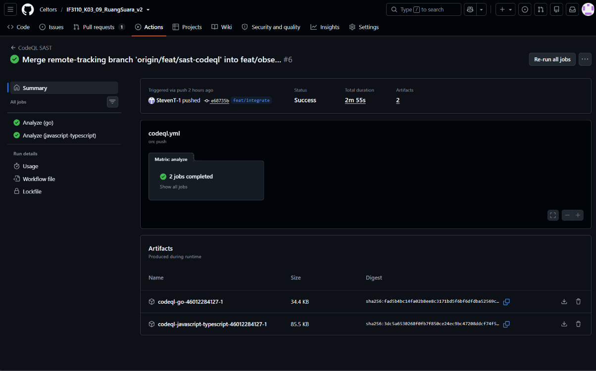
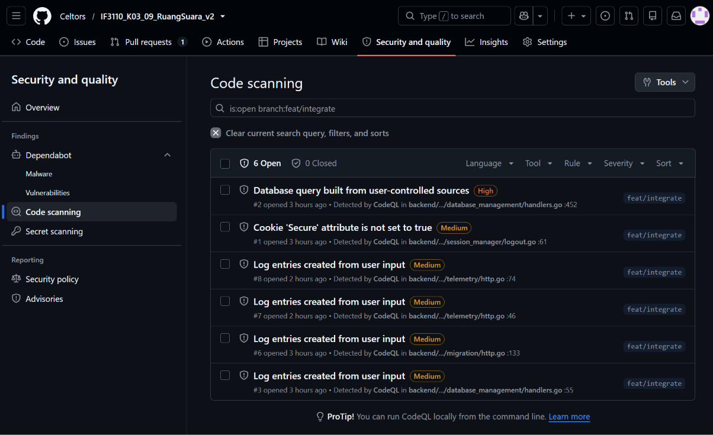
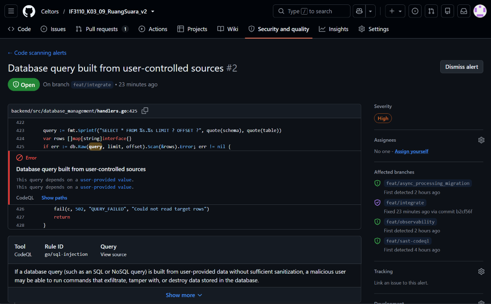
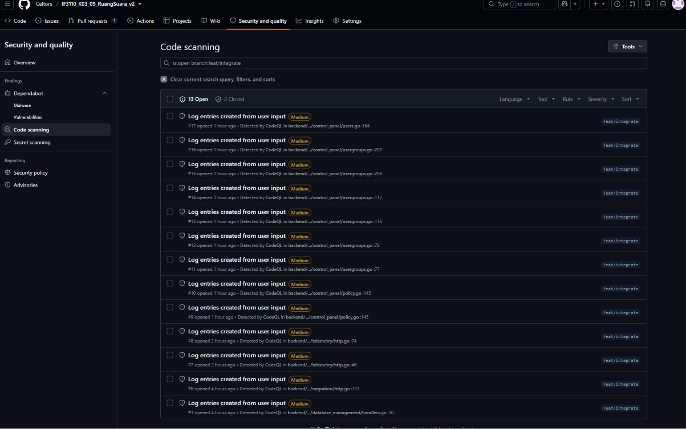

# Static Application Security Testing (SAST) with CodeQL

## 1. Overview

Static Application Security Testing (SAST) examines source code without requiring the application to be running. RuangSuara uses GitHub CodeQL to identify potentially insecure code patterns and trace data from sources to security-sensitive operations. GitHub Actions automates the analysis for the Go backend and JavaScript/JSX frontend.

The purpose of this report is to document the scan evidence, all reported findings, their potential impact, and the proposed decisions and follow-up actions. A CodeQL result is a candidate vulnerability, not automatic proof of exploitability.

**Report status:** Initial scan verified; two source-level corrections verified in Git history; thirteen log-injection findings have source-based false-positive justifications. Post-fix SARIF, test execution evidence and final GitHub dispositions remain pending.

## 2. Implementation and configuration

Repository: [Celtors/IF3110_K03_09_RuangSuara_v2](https://github.com/Celtors/IF3110_K03_09_RuangSuara_v2).

| Configuration | Implementation |
| --- | --- |
| Workflow | [`.github/workflows/codeql.yml`](../.github/workflows/codeql.yml) |
| Query configuration | [`.github/codeql/codeql-config.yml`](../.github/codeql/codeql-config.yml) |
| Automation | GitHub Actions, `ubuntu-latest` |
| Triggers | Pushes and pull requests targeting `main` or `feat/**`; weekly schedule; manual dispatch |
| Schedule | `23 3 * * 1` (Monday 03:23 UTC / 10:23 WIB, default branch only) |
| Languages | `go`, `javascript-typescript` |
| Go build | Manual: `go build ./...` in `backend/src`, Go 1.26.1, C compiler installed, `CGO_ENABLED=1` |
| JavaScript build | None; source extraction without Vite build or npm installation |
| Query suite | Default queries retained; `security-extended` added for broader security coverage |
| Exclusions | `frontend/dist/**`, `frontend/dist-ssr/**`, `frontend/coverage/**`, `**/node_modules/**` (generated output and installed dependencies) |
| Evidence | SARIF uploaded to GitHub Code scanning and preserved with metadata as workflow artifacts (30-day retention) |

The `security-extended` suite broadens the set of security checks beyond the default suite. Additional findings may require more manual review. No security rule suppression is configured in the supplied workflow. Test source is not deliberately excluded by the paths-ignore configuration; actual extraction coverage is discussed below.

## 3. Verified initial scan

The baseline for this report is the **push scan on `feat/integrate`**, not the earlier pull-request scan.

| Evidence field | Verified value |
| --- | --- |
| Workflow run | [CodeQL SAST — run 46012284127](https://github.com/Celtors/IF3110_K03_09_RuangSuara_v2/actions/runs/46012284127) |
| Run attempt | 1 |
| Event | `push` |
| Git ref | `refs/heads/feat/integrate` |
| Scanned commit | [`e68735b2d9dae5efd4ae1c4b3a27fc94eca76e47`](https://github.com/Celtors/IF3110_K03_09_RuangSuara_v2/commit/e68735b2d9dae5efd4ae1c4b3a27fc94eca76e47) |
| Scan date | 27 November 2026 (UTC) |
| JavaScript metadata timestamp | 14:02:40 UTC |
| Go metadata timestamp | 14:04:29 UTC |
| CodeQL CLI | 2.27.6 |
| Query suite | Default + `security-extended` |
| Analysis mode | Full push analysis; both logs state that the diff-informed stage was skipped because no precomputed diff ranges existed |
| Backend build | Completed, allowing Go analysis to proceed |
| Go / JavaScript analysis | Both SARIF invocations report `executionSuccessful: true` |
| Code scanning upload | Both jobs report `Successfully uploaded results` and `Analysis upload status is complete.` |
| Artifact upload | Both artifacts successfully finalized |

Both baseline SARIF metadata files identify the same integration-branch commit. The updated repository archive is on `docs/sast-ql-initial-report` at `61867bc4d51afa74749baa8f0eb434f7049d8340`, with the authentication correction in its ancestry. The local `feat/integrate` reference is `065c750`; the archived `origin/feat/integrate` reference is `b2cf56f5a1bd4a54f5ec67f1ed976a968d732938`. The latter commit was inspected directly for the database viewer correction; it is not yet an ancestor of the documentation branch HEAD. The reported subsequent README commit `eaf4c3e` is not available in the archive. The supplied baseline dashboard screenshot independently confirms six open alerts and their GitHub numbers. Later dashboard states are taken from the supplied remediation history, pending supporting evidence.

### 3.1 Evidence files

The supplied `docs.zip` already contains these archives and three screenshots in `docs/evidence/initial/`. Preserve them in place. All relative links in this document are resolved from `docs/sast-codeql.md`.

| Evidence | Contents |
| --- | --- |
| [`codeql-go-46012284127-1.zip`](evidence/initial/codeql-go-46012284127-1.zip) | `sarif/go.sarif`, `metadata.json`; artifact ID `15204980187` |
| [`codeql-javascript-typescript-46012284127-1.zip`](evidence/initial/codeql-javascript-typescript-46012284127-1.zip) | `sarif/javascript.sarif`, `metadata.json`; artifact ID `15204328369` |
| [`logs_124479857497.zip`](evidence/initial/logs_124479857497.zip) | Original workflow logs for both matrix jobs |

SHA-256 checksums of the archives in the supplied `docs.zip` (recomputed and matched to the initial report):

```
fad5b4bc14fa02b8ee8c3171bd5f6bf6dfdba52569c31cce685e574d2b3c2e46  codeql-go-46012284127-1.zip
3dc5a6530268f0fb7f850ce24ec9bc47208ddcf74f5b671b0f374a1b1c01c2cb  codeql-javascript-typescript-46012284127-1.zip
f2a668ab1b7bf0d2af8da964f6f2761dfa81b7e02427598b3f3e9a9e48e0e7aa  logs_124479857497.zip
```

Relevant log entries are found in each `Analyze (<language>)/8_Analyze and upload to code scanning.txt` file and each `9_Preserve SARIF and metadata.txt` file. Before committing evidence, review archives for credentials, sensitive logs and unintended source exposure. Do not commit `.env`.

- Workflow summary with both successful analysis jobs, run URL, branch and commit.


- Code scanning dashboard filtered to `feat/integrate` with findings.


- Sample of individual alert detail screenshots


## 4. Analysis coverage

Coverage figures are taken from SARIF metric results, extraction diagnostics and the Actions logs, not estimated from repository size.

| Metric | Go | JavaScript/TypeScript |
| --- | ---: | ---: |
| Lines of code in CodeQL database | 8,209 | 6,798 |
| User-written lines (separate metric) | Not reported | 6,768 |
| Successfully extracted language source files | 55 `.go` | 28 `.js` + 60 `.jsx` |
| Log-reported coverage | 55 of 65 Go files | 28 of 28 JavaScript files |
| Security findings | 6 | 0 |

The JavaScript diagnostic also identifies 12 other extracted files (YAML/YML, HTML and JSON), for 100 distinct diagnostic file paths. The Go diagnostic lists 57 distinct paths (55 Go files, one HTML file and `go.mod`). Incidental extraction of configuration does not establish dedicated GitHub Actions, YAML, SQL or infrastructure security coverage. No separate Actions language job was configured.

**Go coverage limitation:** The Go logs report 55 of 65 expected Go files scanned (84.6%). Comparing `cli/expected-extracted-files/go` with `go/diagnostics/successfully-extracted-files` in the Go SARIF identifies the following ten test files absent from the successful extraction list:

- `backend/src/access_control/effect/effect_extended_test.go`
- `backend/src/access_control/effect/effect_test.go`
- `backend/src/database_management/accessible_test.go`
- `backend/src/database_management/models_test.go`
- `backend/src/database_management/provider_test.go`
- `backend/src/migration/job_integration_test.go`
- `backend/src/migration/migration_test.go`
- `backend/src/migration/query_integration_test.go`
- `backend/src/migration/query_test.go`
- `backend/src/migration/review_test.go`

Although the workflow sets `CODEQL_EXTRACTOR_GO_OPTION_EXTRACT_TESTS=true`, this run does not demonstrate successful extraction of those test files. The manual `go build ./...` builds non-test packages; investigate the extraction configuration and a supported test-build approach, then verify actual coverage in a subsequent run. Do not assume the environment variable alone proves test coverage.

**Frontend result:** CodeQL returned zero JavaScript/TypeScript findings. This means no findings were produced by the configured queries for the extracted code at this commit; it does not establish that the frontend is secure.

## 5. Findings and remediation history

The verified baseline contains six Go results across three rule IDs and zero JavaScript results. The SQL injection result contains four reported paths, not four separate alerts. Severity is the CodeQL rule's security-severity score, not an independently calculated application CVSS score.

| Rule | CWE | Security severity | Baseline raw results |
| --- | --- | --- | ---: |
| [`go/cookie-secure-not-set`](https://codeql.github.com/codeql-query-help/go/go-cookie-secure-not-set/) | CWE-614 | Medium (4.0) | 1 |
| [`go/sql-injection`](https://codeql.github.com/codeql-query-help/go/go-sql-injection/) | CWE-89 | High (8.8) | 1 |
| [`go/log-injection`](https://codeql.github.com/codeql-query-help/go/go-log-injection/) | CWE-117 | Medium (6.1) | 4 |
| **Total** | | | **6** |

Nine additional log-injection alerts were reported after authentication changes, according to the supplied implementation history. The baseline six alert numbers and locations are confirmed by SARIF and the initial screenshot; the nine later numbers and their mapping are reported by the implementation history and must be matched to their own SARIF/alert details. Report IDs below are stable local identifiers, not GitHub alert numbers.

### 5.1 Commit history

| Commit | Description | Verification |
| --- | --- | --- |
| [e68735b](https://github.com/Celtors/IF3110_K03_09_RuangSuara_v2/commit/e68735b2d9dae5efd4ae1c4b3a27fc94eca76e47) | Baseline integration with SAST | Git object and initial SARIF verified |
| [d5e658a](https://github.com/Celtors/IF3110_K03_09_RuangSuara_v2/commit/d5e658abf4d15bf7de578f06fbfb8cdeb9d3ef50) | Enforce session lifecycle and access control; add administrative activity logs | Git object and implementation verified |
| [40a6dcb](https://github.com/Celtors/IF3110_K03_09_RuangSuara_v2/commit/40a6dcbee253cc5b04d723d44e9004caeee8c0c8) | Add unit testing | Git object verified; execution evidence pending |
| [065c750](https://github.com/Celtors/IF3110_K03_09_RuangSuara_v2/commit/065c7503598751537676cfcfc879c73606634d4c) | Add k6 testing; authentication correction scan revision | Git object verified; scan evidence pending |
| [b2cf56f](https://github.com/Celtors/IF3110_K03_09_RuangSuara_v2/commit/b2cf56f5a1bd4a54f5ec67f1ed976a968d732938) | Complete database viewer and enforce target isolation | Git object and implementation verified on archived remote integration ref |
| `eaf4c3e` | Subsequent README update | Reported by implementation history; Git object unavailable in archive |

### 5.2 Individual finding register

All locations are relative to `backend/src/` and refer to the scan revision, not necessarily the current line numbers. The rule and severity in the first table apply individually to each row below. The `#` numbers are GitHub alert numbers.

| ID / alert | Rule | Severity | Scan location | Potential impact in RuangSuara | Decision / justification | Fix commit | Verification status |
| --- | --- | --- | --- | --- | --- | --- | --- |
| SAST-01 / #1 | `go/cookie-secure-not-set` | Medium 4.0 | `access_control/session_manager/logout.go:61` | Inconsistent session cookie security; deletion cookie could be emitted without Secure | Fix; shared Secure cookie helper | `d5e658a` | Source fixed; no longer open according to implementation history; closure evidence pending |
| SAST-02 / #2 | `go/sql-injection` | High 8.8 | `database_management/handlers.go:452` | Unintended target SQL execution if identifier context is broken; placeholder ambiguity could disrupt viewer | Fix query construction; native pgx identifier quoting and value parameters | `b2cf56f` | Source fixed at commit; re-scan disposition pending |
| SAST-03 / #7 | `go/log-injection` | Medium 6.1 | `internal/telemetry/http.go:46` | Forged panic events could mislead incident investigation | False positive recommended; registered route template | N/A | Source justification verified; dismissal pending |
| SAST-04 / #8 | `go/log-injection` | Medium 6.1 | `internal/telemetry/http.go:74` | Forged request telemetry could mislead monitoring | False positive recommended; registered route template | N/A | Source justification verified; dismissal pending |
| SAST-05 / #3 | `go/log-injection` | Medium 6.1 | `database_management/handlers.go:55` | Forged database failure audit records | False positive recommended; registered route template | N/A | Source justification verified; dismissal pending |
| SAST-06 / #6 | `go/log-injection` | Medium 6.1 | `migration/http.go:133` | Forged migration failure audit records | False positive recommended; registered route template | N/A | Source justification verified; dismissal pending |
| SAST-07 / #17 | `go/log-injection` | Medium 6.1 | `access_control/control_panel/users.go:156` | Forged account deactivation audit records via `affected_user_id` | False positive recommended; typed UUID → canonical string → validated attribute | N/A | Source control verified; SARIF mapping and dismissal pending |
| SAST-08 / #11 | `go/log-injection` | Medium 6.1 | `access_control/control_panel/usergroups.go:77` | Forged membership addition audit records via `group_id` | False positive recommended; typed UUID → canonical string → validated attribute | N/A | Source control verified; SARIF mapping and dismissal pending |
| SAST-09 / #12 | `go/log-injection` | Medium 6.1 | `access_control/control_panel/usergroups.go:78` | Forged membership addition audit records via `affected_user_id` | False positive recommended; typed UUID → canonical string → validated attribute | N/A | Source control verified; SARIF mapping and dismissal pending |
| SAST-10 / #13 | `go/log-injection` | Medium 6.1 | `access_control/control_panel/usergroups.go:116` | Forged membership removal audit records via `group_id` | False positive recommended; typed UUID → canonical string → validated attribute | N/A | Source control verified; SARIF mapping and dismissal pending |
| SAST-11 / #14 | `go/log-injection` | Medium 6.1 | `access_control/control_panel/usergroups.go:117` | Forged membership removal audit records via `affected_user_id` | False positive recommended; typed UUID → canonical string → validated attribute | N/A | Source control verified; SARIF mapping and dismissal pending |
| SAST-12 / #15 | `go/log-injection` | Medium 6.1 | `access_control/control_panel/usergroups.go:206` | Forged leader assignment audit records via `group_id` | False positive recommended; typed UUID → canonical string → validated attribute | N/A | Source control verified; SARIF mapping and dismissal pending |
| SAST-13 / #16 | `go/log-injection` | Medium 6.1 | `access_control/control_panel/usergroups.go:207` | Forged leader assignment audit records via `affected_user_id` | False positive recommended; typed UUID → canonical string → validated attribute | N/A | Source control verified; SARIF mapping and dismissal pending |
| SAST-14 / #9 | `go/log-injection` | Medium 6.1 | `access_control/control_panel/policy.go:145` | Forged policy change audit records via `group_id` | False positive recommended; typed UUID → canonical string → validated attribute | N/A | Source control verified; SARIF mapping and dismissal pending |
| SAST-15 / #10 | `go/log-injection` | Medium 6.1 | `access_control/control_panel/policy.go:145` | Forged policy change audit records via `database_id` | False positive recommended; typed UUID → canonical string → validated attribute | N/A | Source control verified; SARIF mapping and dismissal pending |

For SAST-14 and SAST-15 in particular, the mapping of alert number to individual argument at the shared source line is provisional until the actual SARIF/alert code flow is checked. No alerts have been dismissed during report preparation.

## 6. Remediation details and justification

### 6.1 SAST-01 — Insecure cookie configuration (fixed in source)

**Rule:** `go/cookie-secure-not-set` (CWE-614, Medium 4.0). The baseline finding was emitted at `logout.go:61`:

```go
c.SetCookie("ssid", "", -1, "/", "", false, true)
```

The deletion response did not set Secure, unlike the login cookie. Since this particular response carries an empty deletion value, actual session-token disclosure at this sink was not demonstrated; consistent security attributes nevertheless warrant correction.

**Fix:** [d5e658a — enforce session lifecycle and access control](https://github.com/Celtors/IF3110_K03_09_RuangSuara_v2/commit/d5e658abf4d15bf7de578f06fbfb8cdeb9d3ef50). Verified in the supplied repository: `backend/src/access_control/session_manager/authorization.go:216–225` defines the shared helper:

```go
func setSessionCookie(c *gin.Context, token string, expires time.Time) {
    cookie := &http.Cookie{
        Name: sessionCookie, Value: token, Path: "/",
        Secure: true, HttpOnly: true, SameSite: http.SameSiteLaxMode, Expires: expires,
    }
    if token == "" {
        cookie.MaxAge = -1
    }
    http.SetCookie(c.Writer, cookie)
}
```

Login (`login.go:86`), renewal (`authorization.go:197`) and logout (`logout.go:62`) call the same helper. The cookie is host-only, Secure, HttpOnly, SameSite=Lax and scoped to `/`. Logout revokes the server-side session first and returns a failure if revocation fails rather than incorrectly clearing the browser cookie and claiming success. This addresses the specific missing attribute and improves session lifecycle consistency.

**Regression coverage:** `backend/src/session_integration_test.go`, `TestSessionAndAdminIntegration`, checks login cookie attributes (lines 92–94), failed revocation (174) and deletion attributes matching the active cookie (180–181), as well as session lifecycle behavior. The implementation history reports that backend integration tests passed against disposable PostgreSQL 18.6 and browser verification covered login/logout. Test output and browser evidence are not supplied; no tests were executed in preparing this report.

**Re-scan:** [run 46027462987](https://github.com/Celtors/IF3110_K03_09_RuangSuara_v2/actions/runs/46027462987), reported at commit `065c750`. The implementation history reports the cookie alert was no longer open. Independent confirmation requires the post-authentication SARIF and the GitHub alert #1 closed/fixed detail.

### 6.2 SAST-02 — SQL injection candidate (query construction corrected)

**Rule:** `go/sql-injection` (CWE-89, High 8.8). The baseline SARIF traces `c.Param("schema")` and `c.Param("table")` through custom identifier quoting and `fmt.Sprintf` into `db.Raw(query, limit, offset)` at `backend/src/database_management/handlers.go:452`.

```go
quote := func(s string) string { return `"` + strings.ReplaceAll(s, `"`, `""`) + `"` }
query := fmt.Sprintf("SELECT * FROM %s.%s LIMIT ? OFFSET ?", quote(schema), quote(table))
```

The original code escaped PostgreSQL identifiers, checked relation existence and bound pagination values. The alert alone did not prove conventional SQL injection. However, a valid quoted identifier containing `?` could interfere with GORM question-mark placeholder processing. Improving the query construction was warranted; an exploitable breakout from quoted identifiers was not established.

**Fix:** [b2cf56f — complete database viewer and enforce target isolation](https://github.com/Celtors/IF3110_K03_09_RuangSuara_v2/commit/b2cf56f5a1bd4a54f5ec67f1ed976a968d732938). Inspected directly using the Git object because the documentation branch worktree does not yet include this commit. In `backend/src/database_management/viewer.go` at that revision:

- Lines 26–49: native pgx pool; read-only transaction; reserved ledger schema rejected; query/lock timeouts and restricted search path.
- Lines 127–133: relation existence check with `$1` and `$2` value parameters.
- Lines 136–149: pagination validated; schema and table quoted by `pgx.Identifier{schema, table}.Sanitize()`.
- Lines 151–165: optional ordering keys derived from PostgreSQL catalog metadata using `quote_ident`, or a constant fallback.
- Lines 166 and 180–182: native PostgreSQL pagination placeholders and driver argument binding via `textRows` and `tx.Query`.

```go
relation := pgx.Identifier{schema, table}.Sanitize()
// Optional ORDER BY is built from quoted catalog identifiers or a fixed fallback.
columns, data, err := textRows(ctx, tx, sql+" LIMIT $1 OFFSET $2", limit+1, offset)
```

SQL identifiers cannot be bound as ordinary SQL values. Established driver quoting preserves the identifier context; numeric pagination values are bound separately without the former GORM placeholder-processing ambiguity. The viewer retains authorization checks and relation validation; read-only execution limits persistent writes but is not a substitute for correct quoting or protection against unauthorized reads.

**Regression coverage:** At `b2cf56f`, `backend/src/activity_integration_test.go`, `TestActivityLoggingThroughWorker`, subtest `registration protection and viewer` (435 onwards), creates unusual schema and table names containing slash, whitespace, question mark and a double quote (475–488). It asserts column metadata, denied access before ViewOnly permission (497–502), paging and exact result values (518–525), nonexistent table and reserved-schema rejection (528–529). These assertions are present in Git. The implementation history reports successful backend integration tests against disposable PostgreSQL 18.6 and desktop/mobile viewer checks. Execution output has not been provided.

**Re-scan:** [run 46031632813](https://github.com/Celtors/IF3110_K03_09_RuangSuara_v2/actions/runs/46031632813) is reported successful for `b2cf56f`; the later [run 46032617920](https://github.com/Celtors/IF3110_K03_09_RuangSuara_v2/actions/runs/46032617920) is reported for `eaf4c3e`. Neither post-fix SARIF is available. Confirm whether #2 is fixed, and separately assess any new SQL alert on the native pgx query. A successful workflow is not sufficient proof of closure.

### 6.3 SAST-03–06 — Route-template log injection (no source fix recommended)

**Rule:** `go/log-injection` (CWE-117, Medium 6.1). Unsafe plain-text logging could permit attacker-supplied control characters to create forged entries and impair incident response. The four baseline findings concern logging of Gin's `c.FullPath()`, which returns the registered route template, not the actual URL path with user-controlled substitutions. Unmatched routes can return an empty string. Route registration uses server-defined patterns.

| Finding | Source-to-sink explanation | Why no fix is recommended |
| --- | --- | --- |
| SAST-03 / #7 | `c.FullPath()` → route variable → panic `slog` event in `internal/telemetry/http.go` | Registered template; raw path and panic payload are not the flagged attribute |
| SAST-04 / #8 | `c.FullPath()` → route variable → HTTP completion `slog` event in `internal/telemetry/http.go` | Route parameters do not alter the template; method normalization is separate |
| SAST-05 / #3 | `c.FullPath()` → `slog.WarnContext` in `database_management/handlers.go` | Logged route is a registered template, not the request database identifier |
| SAST-06 / #6 | `c.FullPath()` → `slog.WarnContext` in `migration/http.go` | Logged route is a registered template, not submitted SQL or request body |

For example, a request to `/databases/12345` matches `/databases/:id`; only the latter is logged as the route. `backend/src/internal/telemetry/log.go:63–77` configures `slog.NewJSONHandler`, so strings are JSON encoded rather than concatenated as plain-text log lines. The OTLP bridge emits structured records; verify downstream consumers independently if enabled. The fixed route template is the primary protection; JSON encoding is defense in depth.

**Decision:** Retain useful route telemetry; recommend false-positive disposition for each of the four specific flows. Removing these records would reduce diagnostic value without fixing a demonstrated injection weakness. No rule suppression or additional source change is needed for these flows if the final alert details confirm the same source and sink.

**Verification:** `backend/src/internal/telemetry/telemetry_test.go:63–127`, `TestHTTPLogging`, checks normal requests, panic, unmatched paths, registered template `/databases/:id`, parsed event count and absence of private request values. `TestOTLPPreservesLoggingPolicyAndCorrelation` in `internal/telemetry/export_test.go` checks the structured export path. Existing assertions do not by themselves prove control-character handling in all four failure paths. Capture focused test output for malicious route parameters, unmatched routes, panic, database failures and migration failures; ensure each record stays a single structured event. No execution result or formal dismissal is supplied.

### 6.4 SAST-07–15 — Administrative identifier log injection (no source fix recommended)

**Rule:** `go/log-injection` (CWE-117, Medium 6.1). The supplied implementation history associates nine new alerts with activity logging introduced by `d5e658a`. Administrative user, group and policy changes now emit structured audit events. Attacker-controlled text in such events could falsify attribution if logged without neutralization.

The archived post-authentication source verifies the following nine argument paths. Each uses a typed `uuid.UUID` value (JSON bind errors return before logging), converted to its canonical representation by `.String()`, followed by `telemetry.ID`. The helper at `backend/src/internal/telemetry/log.go:40–47` accepts only 32- or 36-character strings that parse as UUIDs and returns an empty attribute otherwise. For these callers the value has already been canonicalized. The local JSON logger then encodes the attribute as a structured string.

| Finding / reported alert | Value passed to `telemetry.ID` | Source and operation |
| --- | --- | --- |
| SAST-07 / #17 | `telemetry.ID("affected_user_id", userQuery.ID.String())` | Typed UUID from account deactivation; `access_control/control_panel/users.go:156` |
| SAST-08 / #11 | `telemetry.ID("group_id", userGroupPayload.GroupId.String())` | Typed UUID from membership addition; `access_control/control_panel/usergroups.go:77` |
| SAST-09 / #12 | `telemetry.ID("affected_user_id", userGroupPayload.UserId.String())` | Typed UUID from membership addition; `access_control/control_panel/usergroups.go:78` |
| SAST-10 / #13 | `telemetry.ID("group_id", userGroupPayload.GroupId.String())` | Typed UUID from membership removal; `access_control/control_panel/usergroups.go:116` |
| SAST-11 / #14 | `telemetry.ID("affected_user_id", userGroupPayload.UserId.String())` | Typed UUID from membership removal; `access_control/control_panel/usergroups.go:117` |
| SAST-12 / #15 | `telemetry.ID("group_id", leader.GroupId.String())` | Typed UUID from leader assignment; `access_control/control_panel/usergroups.go:206` |
| SAST-13 / #16 | `telemetry.ID("affected_user_id", leader.LeaderId.String())` | Typed UUID from leader assignment; `access_control/control_panel/usergroups.go:207` |
| SAST-14 / #9 | `telemetry.ID("group_id", policy.GroupId.String())` | Typed UUID from policy change; `access_control/control_panel/policy.go:145` |
| SAST-15 / #10 | `telemetry.ID("database_id", policy.DatabaseId.String())` | Typed UUID from policy change; `access_control/control_panel/policy.go:145` |

The user update payload, group membership payload and group policy payload all declare UUID-typed identifier fields. For leadership assignment, `GetLeaderStruct()` copies typed UUIDs into `models.GroupLeader`. `logPolicyChange` receives `GroupPolicyPayload` and logs its two UUID fields. Administrative routes are also protected by platform-admin middleware; authorization alone is not the reason these particular log arguments are safe.

```text
HTTP JSON request → typed UUID decoding → canonical UUID string
    → telemetry.ID validation → structured slog attribute → JSON / OTLP record
```

Canonical UUID text contains hexadecimal digits and hyphens, not arbitrary log prefixes or control characters. Consequently the user may select an identifier but cannot preserve arbitrary injected log text through these conversions. Existing audit logs should be retained to support accountability. The source-level justification is established for the listed arguments; precise post-authentication SARIF paths and GitHub alert numbers still require verification (especially the two policy arguments on the same line). The affected-user log moved to line 164 at `b2cf56f`; use fingerprints and exact arguments, not line numbers alone, when matching later scans.

**Decision:** Recommend false-positive disposition individually for SAST-07 through SAST-15, conditional on confirming the reported SARIF paths. No accepted risk or formal dismissal is claimed. If a later alert instead flags an unrestricted string, review it independently.

**Verification:** Exercise the administrative endpoints with valid UUIDs and malformed UUID strings containing control characters; verify malformed inputs are rejected and successful events contain canonical IDs only. Check `telemetry.ID` directly for invalid strings, and verify structured event boundaries. The existing integration tests and reported test pass do not replace focused evidence of these exact paths.

- TODO — add `evidence/repaired/false-positives/uuid-logging-tests.txt`.
- TODO — capture individual alert details/dispositions for #9–#17 and preserve the post-authentication SARIF.

### 6.5 Consolidated decisions

| Category | Count | Status |
| --- | ---: | --- |
| Source-level corrections | 2 | Cookie and SQL construction verified in Git; post-fix closure evidence pending |
| Route-template false-positive recommendations | 4 | Source review completed; final disposition pending |
| UUID log false-positive recommendations | 9 | Source review completed; later SARIF mapping and final disposition pending |
| Accepted risks | 0 | None claimed |
| **Distinct findings reported across the first two stages** | **15** | 6 baseline verified + 9 later reported; not a current open-alert count |

For a confirmed false positive, select **False positive** on the corresponding GitHub alert and record the reasoning from Section 6.3 or 6.4, reviewer and date. Do not dismiss real weaknesses or disable rules. If an accepted risk is identified later, document the residual impact, compensating control, approval/owner and revisit date. No accepted risk is needed for the current proposed dispositions.

## 7. Re-scan results and evidence

### 7.1 Scan history and comparison

The baseline is verified from raw artifacts and a screenshot. Later workflow success and the intermediate dashboard counts are reported by the supplied implementation history, not independently verified against GitHub or post-fix artifacts. Keep raw SARIF results distinct from dashboard open/fixed/dismissed states; a dismissed result can still appear in raw SARIF.

| Stage | Commit | Workflow run | Evidence status |
| --- | --- | --- | --- |
| Initial | `e68735b` | [46012284127](https://github.com/Celtors/IF3110_K03_09_RuangSuara_v2/actions/runs/46012284127) | Verified: both jobs successful; SARIF and logs supplied |
| After authentication | `065c750` | [46027462987](https://github.com/Celtors/IF3110_K03_09_RuangSuara_v2/actions/runs/46027462987) | Reported successful; TODO artifacts and dashboard evidence |
| After database viewer | `b2cf56f` | [46031632813](https://github.com/Celtors/IF3110_K03_09_RuangSuara_v2/actions/runs/46031632813) | Reported successful; TODO artifacts and dashboard evidence |
| Subsequent README update | `eaf4c3e` | [46032617920](https://github.com/Celtors/IF3110_K03_09_RuangSuara_v2/actions/runs/46032617920) | Reported successful; TODO artifacts, SHA and dashboard evidence |

| Metric | Initial (verified) | After authentication (reported dashboard) | After viewer (pending) | Latest (pending) |
| --- | ---: | ---: | --- | --- |
| Open cookie alerts | 1 | 0 | TODO | TODO |
| Open SQL injection alerts | 1 | 1 | TODO | TODO |
| Open log injection alerts | 4 | 13 | TODO | TODO |
| Total open alerts | 6 | 14 | TODO | TODO |
| Total closed alerts | 0 | TODO | TODO | TODO |
| Raw Go SARIF findings | 6 | TODO | TODO | TODO |
| Raw JS/TS SARIF findings | 0 | TODO | TODO | TODO |
| Verified fixed alerts | 0 | TODO (#1 reported no longer open) | TODO (#2) | TODO |
| Verified false-positive dismissals | 0 | TODO | TODO | TODO |
| New findings since previous stage | N/A | 9 log injection (reported) | TODO | TODO |
| CodeQL version | 2.27.6 | TODO | TODO | TODO |
| Go extraction coverage | 55/65 files | TODO | TODO | TODO |
| Go LOC / JS user LOC | 8,209 / 6,768 | TODO | TODO | TODO |
| Scan date (UTC) | 2026-11-27 | TODO | TODO | TODO |

The increase from six to fourteen open findings is explained by one reported cookie closure and nine new reported logging alerts. It is not an independently verified change in exploitability. Do not assume the later raw SARIF count is 13 or that all false positives have been dismissed.

### 7.2 Where to store supporting evidence

Use the existing `docs/evidence/repaired/` directory from the supplied `docs.zip`. Keep `initial/` unchanged. Create the subdirectories below when the relevant evidence is available. Suggested artifact names use the reported run IDs and assume attempt 1; use the actual downloaded names/run attempts and update links if different. Do not create empty SARIF files or fake screenshots. Paths are relative to the repository root.

```text
docs/
├── sast-codeql.md
└── evidence/
    ├── initial/                         # existing verified baseline archives and screenshots
    └── repaired/
        ├── authentication/              # run 46027462987
        │   ├── codeql-go-46027462987-1.zip
        │   ├── codeql-javascript-typescript-46027462987-1.zip
        │   ├── workflow-logs.zip
        │   ├── workflow-summary.png
        │   ├── dashboard.png
        │   ├── alert-1-fixed.png
        │   └── backend-tests.txt
        ├── database-viewer/             # run 46031632813
        │   ├── codeql-go-46031632813-1.zip
        │   ├── codeql-javascript-typescript-46031632813-1.zip
        │   ├── workflow-logs.zip
        │   ├── workflow-summary.png
        │   ├── alert-2-status.png
        │   └── backend-tests.txt
        ├── false-positives/
        │   ├── route-logging-tests.txt
        │   ├── uuid-logging-tests.txt
        │   └── alert-<number>.png        # one for each of 3, 6, 7, 8, 9–17
        └── final/                       # run 46032617920 or newer final run
            ├── codeql-go-46032617920-1.zip
            ├── codeql-javascript-typescript-46032617920-1.zip
            ├── workflow-logs.zip
            ├── workflow-summary.png
            ├── open-alerts.png
            ├── closed-alerts.png
            ├── alerts.json
            └── coverage.png
```

The following placeholders are the intended insertion points for supporting evidence. Uncomment or convert to Markdown links only after saving the actual file. Keep evidence screenshots readable and include the branch filter, alert number and disposition where relevant.

| Evidence to add | Target path relative to this report | Supports | Status |
| --- | --- | --- | --- |
| Authentication workflow screenshot | `evidence/repaired/authentication/workflow-summary.png` | Run success and commit | TODO |
| Authentication dashboard screenshot | `evidence/repaired/authentication/dashboard.png` | Reported 14 open alerts | TODO |
| Cookie closure screenshot | `evidence/repaired/authentication/alert-1-fixed.png` | SAST-01 | TODO |
| Authentication SARIF and logs | `evidence/repaired/authentication/` | SAST-01 closure and nine new alerts | TODO |
| Viewer workflow screenshot | `evidence/repaired/database-viewer/workflow-summary.png` | SQL correction re-scan | TODO |
| SQL alert detail | `evidence/repaired/database-viewer/alert-2-status.png` | SAST-02 fixed/open/new flow | TODO |
| Viewer SARIF and logs | `evidence/repaired/database-viewer/` | SAST-02 re-scan | TODO |
| Individual false-positive alert details and dismissal reason | `evidence/repaired/false-positives/alert-<number>.png` | SAST-03–15 | TODO for each |
| Focused test logs | `evidence/repaired/authentication/backend-tests.txt`, `evidence/repaired/database-viewer/backend-tests.txt`, `evidence/repaired/false-positives/` | Regression and data-flow justifications | TODO |
| Final SARIF, logs and screenshots | `evidence/repaired/final/` | Final raw results, dashboard state, coverage | TODO |

<!-- Insert the evidence here after adding the files:


-->

### 7.3 Evidence collection and disposition checklist

1. Open each linked Actions run, confirm both matrix jobs and upload status, download both language artifacts and the workflow logs. Record `metadata.json` values (SHA, branch/ref, timestamp, version and query suite).
2. Open [Code scanning](https://github.com/Celtors/IF3110_K03_09_RuangSuara_v2/security/code-scanning), filter to `feat/integrate`, and inspect #1 and #2 under both open and closed states. Capture their actual fixed/dismissed status and relevant code flow.
3. Match all thirteen proposed false positives to their alert detail, including the two policy arguments at the same line. Record the reviewer, decision, date and supporting test. Only dismiss as `False positive` once the exact flow is verified.
4. Update the latest counts, extraction coverage and all statuses above. If the SQL query correction introduces a new result, add a separate finding with its own decision and evidence. If more recent commits exist, use a final full branch scan with the same query configuration.
5. Preserve logs after checking for secrets and sensitive data. Do not commit `.env` or database credentials.

Optional GitHub CLI commands (run with repository access; replace `RUN_ID` with the actual run ID and use the corresponding evidence directory):

```bash
gh run view RUN_ID --repo Celtors/IF3110_K03_09_RuangSuara_v2 --log > workflow-log.txt
gh run download RUN_ID --repo Celtors/IF3110_K03_09_RuangSuara_v2 --pattern 'codeql-*'
gh api --paginate --slurp 'repos/Celtors/IF3110_K03_09_RuangSuara_v2/code-scanning/alerts?ref=refs/heads/feat/integrate&per_page=100' > alerts.json
```

`gh run download` extracts artifacts into directories; if preserving the exact ZIP filenames above, download the original archives through the web UI. Keep the actual download format and update the evidence references accordingly.

### 7.4 Regression testing status

| Validation | Evidence/status |
| --- | --- |
| Baseline `go build ./...` | Verified successful in initial CodeQL logs |
| Session integration tests | Assertions verified in source; implementation history reports pass; TODO execution output |
| Viewer integration tests (unusual identifiers, pagination, authorization) | Assertions verified at `b2cf56f`; implementation history reports pass; TODO execution output |
| HTTP and OTLP telemetry tests | Existing test code verified; TODO focused execution output |
| UUID log-injection regression checks | TODO targeted test / output |
| Desktop/mobile browser checks | Reported successful; TODO screenshots or test notes |
| Backend `go vet ./...` and full `go test ./...` | TODO exact commands, test configuration and outputs |
| Frontend lint/test/build | TODO outputs if used as regression evidence; not established by CodeQL |

No tests were executed and no repository source changes, GitHub dismissals or live scans were performed in preparing this updated report. The evidence of implementation is Git source inspection; the evidence of later runtime behavior remains to be attached. Record final reviewer and date: **TODO**.

## 8. Limitations and conclusion

CodeQL SAST is enabled and the initial scan successfully analyzed the Go backend and JavaScript/JSX frontend. It reported six backend findings (one High, five Medium) and no frontend findings. Later work corrected cookie configuration and replaced the database viewer's SQL construction; these two changes are verified in commits `d5e658a` and `b2cf56f`. Thirteen log-injection findings (four baseline and nine subsequently reported) have specific source-based justifications for retaining route-template and canonical UUID logging. These are recommended false positives, not formally verified GitHub dismissals.

The remaining submission requirements are to attach post-fix SARIF and logs, establish the final state of the cookie and SQL alerts, verify each logging disposition and its test evidence, and record final extraction coverage. The archived documentation branch must also be integrated with the database viewer fix if it is to represent the final implementation. Neither the final open-alert count nor the raw result count is inferred from a green workflow.

CodeQL is limited by query coverage, extraction and framework modeling. The baseline missed ten expected Go test files; zero frontend findings are not proof of frontend safety. Runtime configuration, business logic and authorization design, dependency CVEs and dynamic attack behavior require complementary review and testing. **A clean CodeQL result does not prove that the application is secure.**

## References

- [OWASP — Static Application Security Testing](https://owasp.org/www-community/Source_Code_Analysis_Tools)
- [CodeQL — Secure cookie attribute](https://codeql.github.com/codeql-query-help/go/go-cookie-secure-not-set/)
- [CodeQL — SQL injection](https://codeql.github.com/codeql-query-help/go/go-sql-injection/)
- [CodeQL — Log injection](https://codeql.github.com/codeql-query-help/go/go-log-injection/)
- [GitHub — Resolving code scanning alerts](https://docs.github.com/en/code-security/how-tos/manage-security-alerts/manage-code-scanning-alerts/resolve-alerts)
- [PostgreSQL pgx driver](https://pkg.go.dev/github.com/jackc/pgx/v5)
- [Go structured logging](https://pkg.go.dev/log/slog)
- [OWASP Session Management Cheat Sheet](https://cheatsheetseries.owasp.org/cheatsheets/Session_Management_Cheat_Sheet.html)
- Primary evidence: original SARIF/log archives and screenshots in `docs/evidence/initial/`; supplied repository Git objects and remediation history (later scan claims pending evidence).

- New repaired alert evidence

